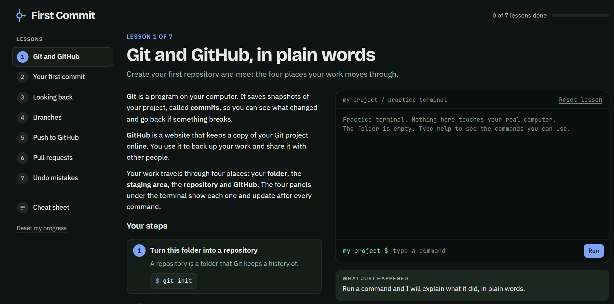

# First Commit

**Learn Git and GitHub by typing real commands, with nothing to install and nothing to break.**

First Commit is a single-page web app with seven short lessons. You type Git commands into a practice terminal, and four live panels show what happens to your files after every command. When something goes wrong, the app explains why in plain words.


<!-- Replace docs/screenshot.png with a screenshot of the running app. -->

## Who it is for

- You have never used Git, or you use it by copying commands you do not fully understand.
- You want to practise safely before touching a real project.
- You are teaching someone else and want something to hand them.

No account, no install, no sign-in. It runs entirely in the browser, and your progress is saved in that browser.

## What you will learn

| # | Lesson | You will practise |
|---|--------|-------------------|
| 1 | Git and GitHub, in plain words | `git init`, `git config`, `git status` |
| 2 | Your first commit | `git add`, `git commit` |
| 3 | Looking back | `git log`, `git log --oneline`, `git diff` |
| 4 | Branches | `git branch`, `git switch -c`, `git merge`, `git branch -d` |
| 5 | Push to GitHub | `git remote add`, `git push -u`, `git push` |
| 6 | Pull requests | pushing a branch, opening and merging a pull request, `git pull` |
| 7 | Undo mistakes | `git restore`, `git restore --staged` |

Each lesson ends with a one-question check. A cheat sheet collects every command in one place.

## How a lesson works

1. Read the short introduction.
2. Follow the steps. Click a command chip to fill it into the terminal, or type it yourself.
3. Press Enter. The terminal replies like real Git, and a note underneath explains what just happened.
4. Watch the panels change.

The four panels are the heart of the app. They show the journey every change takes:

```
Working folder  --git add-->  Staging area  --git commit-->  Repository  --git push-->  GitHub
                                                                  ^                        |
                                                                  +-------git pull---------+
```

| Panel | What it shows |
|-------|---------------|
| Working folder | Your files, tagged untracked, modified, staged, saved or deleted |
| Staging area | What the next commit will contain |
| Repository | Your commit history drawn as a graph, with branch lanes and merge commits |
| GitHub | The online copy, with a pull request flow |

## Run it

Open `first-commit.html` in any modern browser. There is nothing to install.

To change the app, you need Node.js 18 or newer:

```bash
node build.js              # rebuilds first-commit.html from src/
node test/engine.test.js   # runs the Git engine tests
```

## Project layout

```
first-commit/
  first-commit.html      the finished app (one self-contained file)
  build.js               inlines the engine into the page
  src/
    app.src.html         page, styles, lessons and interface
    engine.js            the simulated Git and GitHub
  test/
    engine.test.js       engine tests
```

## How the practice terminal works

The terminal is not a real shell and does not run Git. `src/engine.js` is a small model of a repository: files, a staging area, commits with parent links, branches, remotes, and a pretend GitHub. It reproduces the output of real Git closely, including error messages such as a rejected push or an unknown author identity.

The engine has no dependencies and no access to your computer. Everything lives in memory and disappears when you reload, apart from lesson progress.

### Supported commands

| Group | Commands |
|-------|----------|
| Git | `init`, `config`, `status`, `add`, `commit`, `log`, `diff`, `branch`, `switch`, `checkout`, `merge`, `remote`, `push`, `pull`, `fetch`, `restore` |
| Files | `ls`, `cat`, `touch`, `rm`, `echo "text" > file`, `echo "text" >> file`, `clear`, `help` |

### Known limits

- One flat folder. There are no subfolders.
- GitHub is simulated. You create the repository with a button, and the only valid address is the one shown in the GitHub panel.
- A merge conflict is detected and explained, then the merge is cancelled. You cannot resolve one by hand.
- `clone`, `rebase`, `stash`, `reset` and `tag` are not included.

## Adding or changing a lesson

Lessons are plain objects in the `LESSONS` array inside `src/app.src.html`:

```js
{
  id: 'first-commit',
  short: 'Your first commit',            // label in the sidebar
  title: 'Your first commit',
  blurb: 'Create a file, stage it, and save it as a snapshot.',
  setup: ['git init', /* commands run silently before the lesson starts */],
  intro: ['Paragraph one.', 'Paragraph two.'],
  steps: [
    {
      title: 'Stage the file',
      hint: 'Staging copies the file into the waiting room for the next commit.',
      cmds: ['git add hello.txt'],       // clickable suggestions
      done: function (state, history) { return Object.keys(state.index).length > 0; }
    }
  ],
  quiz: { q: 'Question?', opts: ['A', 'B', 'C'], a: 1, why: 'Why B is right.' }
}
```

A step is complete when its `done` function returns true. It receives the repository state and a helper for checking which commands succeeded, so a step can react to what the learner actually did.

After editing, run `node build.js`, open the page, and try the lesson from start to finish.

## Contributing

Fixes and new lessons are welcome. Before opening a pull request:

1. Run `node test/engine.test.js` and make sure it passes.
2. If you changed the engine, add a test for the new behaviour.
3. Play through the lesson you touched in a browser.

Good lesson ideas: `.gitignore`, merge conflicts, `git clone`, forks.

## License

Add a license before publishing, for example [MIT](https://choosealicense.com/licenses/mit/).
